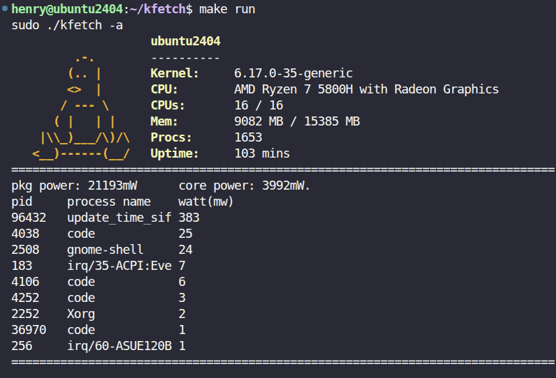

# Kfetch

## Description

kfetch is a Linux kernel module and command-line utility that retrieves and displays system information, including CPU, memory, kernel version, and system uptime.

It also monitors CPU power consumption using AMD-specific RAPL registers and estimates per-process power usage.

## Requirements
* OS: Linux (tested on Ubuntu 24.04, kernel 6.17.0-35-generic)
* Architecture: x86_64
* Hardware: AMD CPU with compatible RAPL energy counters
* Permissions: Root privileges for loading and unloading the kernel module

A native Linux installation is recommended. Power monitoring requires access to AMD-specific RAPL MSRs, which may not be available in virtualized environments.

## Installation
Install dependencies (Ubuntu):
```
sudo apt update
sudo apt install build-essential linux-headers-$(uname -r)
```
Clone the repository, build, and load the kernel module:
```
git clone https://github.com/huanglin-chen/kfetch.git
cd kfetch
make
make load
```

## Usage

Display all available information:
```
make run
```
This is equivalent to `sudo ./kfetch -a`.

Display specific information:
```
sudo ./kfetch -c   # CPU model
sudo ./kfetch -m   # Memory information
sudo ./kfetch -s   # CPU power consumption
sudo ./kfetch -d   # Per-process power information
```
Show other available options:
```
sudo ./kfetch -h
```
Unload the kernel module:
```
make unload
```
### Example Output


## References

* [amd_energy](https://github.com/amd/amd_energy) — Referenced for the implementation of AMD RAPL register access.